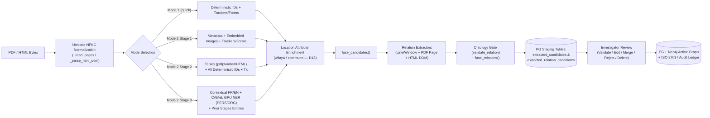
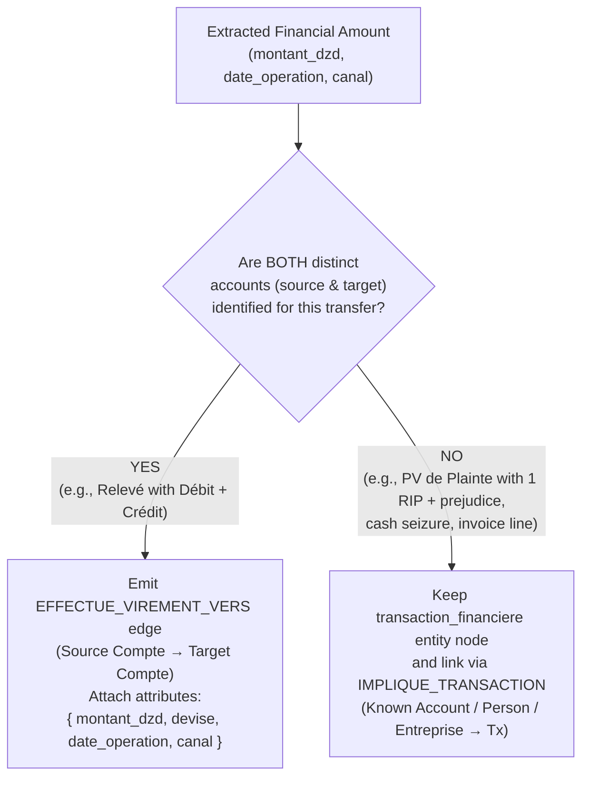

# Athar — Detailed Logic of PDF & HTML Entity and Relation Extraction

> **Scope:** Technical reference documenting how **Athar** extracts entities, geographic attributes, and semantic relations from static **PDF** and **HTML** evidence files without auto-polluting the investigation graph.  
> **Primary Source Modules:**
> - [`apps/studio-app/backend/app/services/extraction/common_extractors.py`](../apps/studio-app/backend/app/services/extraction/common_extractors.py)
> - [`apps/studio-app/backend/app/services/extraction/pdf_extractor.py`](../apps/studio-app/backend/app/services/extraction/pdf_extractor.py)
> - [`apps/studio-app/backend/app/services/extraction/html_extractor.py`](../apps/studio-app/backend/app/services/extraction/html_extractor.py)
> - [`apps/studio-app/backend/app/services/extraction/camel_ner.py`](../apps/studio-app/backend/app/services/extraction/camel_ner.py)
> - [`apps/studio-app/backend/app/services/extraction/wikineural_ner.py`](../apps/studio-app/backend/app/services/extraction/wikineural_ner.py)
> - [`apps/studio-app/backend/app/domain/registry.py`](../apps/studio-app/backend/app/domain/registry.py)

---

## 1. Pipeline Overview & Governance Principles (ISO 27037, D12, D16, D17, D18)

Athar separates **forensic staging** from **verified investigative knowledge**:

1. **Non-Polluting Graph Ingestion (ISO 27037 & D12):** Dropping or uploading a PDF/HTML creates **only** the evidence node (`scelle_numerique`) on the graph, sealed by server-side SHA-256 in PostgreSQL `evidence_files`. Extracted items are stored in staging tables (`extraction_runs`, `extracted_candidates`, `extracted_relation_candidates`) and are **never auto-injected** into `nodes` or `edges`.
2. **No Auto-`VERIFIED` Rule:** Neither static extractors nor CAMeL Tools NER can ever suggest or promote directly into `VERIFIED`. Entity and relation suggestions land in `OSINT_RAW`, `INFRA`, `HYPOTHESIS`, or `FLOWS` until a human investigator validates them with provenance (`EXTRAIT_DE`) or promotes a layer with an explicit judicial reason.
3. **Two Manual Execution Modes:**
   - **Mode 1 — `Analyse Rapide` (`quick`, 1 pass):** Runs document metadata parsing + fast deterministic identifier regexes/DOM extractors (`extract_deterministic_identifiers`) + Stage 1 relations. No contextual FR/EN/AR NER runs in Mode 1.
   - **Mode 2 — `Analyse Complète` (`step_by_step`, 3 human-gated stages):**
     - **Stage 1:** Structural metadata, embedded images (`pymupdf-image-inventory` / `html-embedded-image`), HTML trackers/forms/comments/scripts, and Stage 1 structural relations.
     - **Stage 2:** Full normalized text + table parsing (`pdfplumber` / HTML `<table>`), JSON-LD non-person/non-org data, `@handles`, DZD/EUR/USD financial amounts (`include_transactions=True`), all deterministic identifiers, and Stage 2 relations.
     - **Stage 3:** Contextual FR/EN rules + offline **CAMeL Tools Arabic NER on GPU (`cuda:0`)** (`extract_contextual_entities`), JSON-LD `Person`/`Organization`, social `<article>` posts / Telegram `.message` blocks, and **full combined relation linking** across Stage 1 + Stage 2 + Stage 3 entities.
4. **Attribute-Only Algerian Locations (D18):** `wilaya` and `commune` are **never** emitted as standalone extracted entity nodes. Instead, they are attached as attributes (`wilaya`, `wilayas_mentionnees`, `commune`, `communes_donnees`) on co-occurring entities and summarized in `extraction_runs.summary_json["extracted_locations"]`.



---

## 2. Entity Extraction Logic (Step-by-Step)

### 2.1 Unicode Normalization & Ingestion
Before any regex or neural NER runs:
- **PDF (`pdf_extractor.py`):** `_read_pages()` extracts per-page text with `PyMuPDF` (`fitz`) and applies `unicodedata.normalize("NFKC", page.get_text("text") or "")`. `_extract_pdfplumber_data()` applies `unicodedata.normalize("NFKC", ...)` to extracted layout text and table cells.
- **HTML (`html_extractor.py`):** `_parse_html_dom()` parses HTML strictly offline with `BeautifulSoup4` (stripping `<script>`, `<style>`, `<noscript>` for `visible_text`, sanitizing attributes against `javascript:`, zero network calls) and normalizes `visible_text` with `NFKC`.
- **Arabic Presentation Forms:** Many PDF generators encode Arabic glyphs using **Arabic Presentation Forms-A/B** (`U+FB50–U+FDFF`, `U+FE70–U+FEFF`). `NFKC` (plus `normalize_arabic_text()` in `camel_ner.py`) folds those ligatures back to standard Unicode Arabic (`U+0600–U+06FF`) so `has_arabic_text()` and CAMeL tokenization operate reliably.

### 2.2 Deterministic Identifiers (`extract_deterministic_identifiers` in `common_extractors.py`)
Runs over normalized `(page_num, locator, text)` segments and enforces strict canonical normalization:

| Target Node Type | Pattern / Normalizer | Extractor Tool Tag | Stage / Mode |
| :--- | :--- | :--- | :--- |
| `telephone` | Algerian `05/06/07` & `+213`/`00213` → E.164 `+213...` | `regex-e164-dz` | Mode 1, Stage 2 |
| `compte_bancaire` (RIP) | 20-digit BaridiMob RIP `00799999\d{12}` | `regex-baridimob-rip` | Mode 1, Stage 2 |
| `compte_bancaire` (CCP) | `CCP [: # N°]? (\d{7,12})` | `regex-ccp` | Mode 1, Stage 2 |
| `adresse_email` | Standard RFC-like email, lowercased | `regex-email` | Mode 1, Stage 2 |
| `site_web` | `https?://...` (non-Telegram URLs) | `regex-url` | Mode 1, Stage 2 |
| `canal_telegram` | `t.me/` / `telegram.me/` URLs (`TME_BARE_RE` + `URL_RE`) and optional `@handle` | `regex-telegram-url` / `regex-telegram-handle` | Mode 1, Stage 2 |
| `identifiant_infrastructure` / `serveur_c2` | IPv4 addresses (reclassified to `serveur_c2` if inside `<script>` or `"c2"` context with `ipv4_as_c2_when_script=True`) | `regex-ipv4` / `html-script-c2-ipv4` | Mode 1, Stage 2 |
| `vehicule` | Algerian 5-3-2 plates `\d{5}[\s-]\d{3}[\s-]\d{2}` | `regex-plate-dz` | Mode 1, Stage 2 |
| `crypto_wallet` | Bitcoin (`1.../3.../bc1q...`), Ethereum (`0x[40 hex]`), TRON TRC-20 (`T...`) | `regex-crypto-btc` / `eth` / `trc20` | Mode 1, Stage 2 |
| `transaction_financiere` | Amounts with `DZD` / `DA` / `EUR` / `USD` (`include_transactions=True`) | `regex-amount-dzd` | **Stage 2 only** |

### 2.3 HTML-Specific Extractors (`html_extractor.py`)
In addition to shared deterministic identifiers over HTML segments (`head:meta`, `html:comment#i`, `body:text`, `body:link`, `script:inline#i`):
- **Trackers & Forms (Mode 1 & Stage 1):** Extracts Google Analytics (`UA-...`), GA4 (`G-...`), GTM (`GTM-...`), Meta Pixel (`fbq('init', ...)` → `fb-pixel-...`), Yandex Metrika (`ym-...`), non-`javascript:` `<form action="...">` (`site_web`), explicit `"Canal Telegram @handle"` headings, and `.apk` download links (`fichier_apk`).
- **Inline Images (Stage 1):** Decodes `data:image/...;base64,...` URIs up to 10 MB, computes SHA-256, and stages `image_preuve`.
- **JSON-LD & HTML Tables (Stage 2/3):** Parses `application/ld+json` blocks (`Offer` → `transaction_financiere`, `Person` → `personne` + `compte_social`, `Organization` → `entreprise`) and `<table>` rows (`GAB`, `RIP`, amounts).
- **Social Posts & Telegram Messages (Stage 3):** Extracts `<article data-post-id="...">` (`publication_sociale`) and `.message[data-msg-id]` (`message_chat`), plus `@handles` not already classified as Telegram channels (`compte_social`).

### 2.4 Contextual Rules, CAMeL Tools (Arabic) & WikiNEuRal (French/English/Latin) GPU NER
Runs in **Mode 2 Stage 3**:
1. **French/English Structured Contextual Regexes:**
   - **Companies (`entreprise`):** `SARL|EURL|SPA|SNC|SARL Fictive` prefixes + RC/NIF detection.
   - **Persons (`personne`):** Cue prefixes (`Plaignant|Victime|Suspect|Temoin|Gerant|Directeur|Directrice|Titulaire|Beneficiaire|Admin|Vendeur : Full Name`).
   - **ATMs (`guichet_gab`):** `GAB-[A-Z0-9-]+`.
   - **Mobile Devices (`appareil_mobile`):** `IMEI [: #]? (\d{15})`.
2. **CAMeL Tools Arabic NER on GPU (`camel_ner.py`):**
   - Loads `CAMeL-Lab/bert-base-arabic-camelbert-mix-ner` offline (`HF_MODELS_DIR`), running batched inference on CUDA GPU (`cuda:0`, `NVIDIA T1000`).
   - Masks URLs/emails (`URL_OR_EMAIL_RE`) prior to tokenization and tags Arabic `PERS` → `personne` and `ORG` → `entreprise` (`LOC` routed solely to attributes).
3. **WikiNEuRal Multilingual NER on GPU (`wikineural_ner.py`):**
   - Loads `Babelscape/wikineural-multilingual-ner` offline in `float16` on `cuda:0` (`~346 MB` VRAM) alongside CAMeL Tools.
   - Tags free-form **French, English, and Latin-script** `PER` → `personne` and `ORG` → `entreprise` even when no role cue (`Plaignant:`, `Suspect:`) is present, masking URLs/emails/RIPs/plates and filtering structural/admin stopwords (`Courriel`, `Brigade`, `BaridiMob`).

### 2.5 Location Attribute Enrichment & RIP+CCP Candidate Fusion
1. `extract_location_attributes(segments)` scans normalized text for the 58 Algerian wilayas (French/Latin + `ARABIC_WILAYA_CANONICAL`) and key Algerian communes + CAMeL Arabic `LOC` mentions.
2. `enrich_candidates_with_locations(candidates, page_locations)` attaches `wilaya`, `wilayas_mentionnees`, `commune`, and `communes_donnees` onto each candidate's `attributes` dictionary.
3. `fuse_candidates(items)` deduplicates by `(entity_type, normalized_value.lower())` and runs `_unify_algerie_poste_rip_and_ccp()` so an embedded 10-digit CCP merges cleanly into its parent 20-digit BaridiMob RIP (`attributes["ccp"]`).

---

## 3. Relation Extraction Logic (Step-by-Step)

Relation extraction runs across three complementary layers and then passes through a strict ontology gate before entering staging:

### Layer 1 — Shared Line & 2-Line Window Co-occurrence (`extract_cooccurrence_relations` in `common_extractors.py`)
For each `(page_num, locator, text)` segment:
1. Text is split into non-empty stripped lines `line[0..n-1]`, and a normalized helper `_normalize_match_text()` strips case, NFKC Presentation Forms, and Arabic diacritics (`U+064B–U+065F`, `U+0670`).
2. **Same-Line Pairs (`line[i]`):** Entities matched inside `line` produce directed edges:
   - `personne` × `telephone` → `UTILISE_TELEPHONE`
   - `personne` × `adresse_email` → `UTILISE_EMAIL`
   - `personne` × `compte_bancaire` → `DETIENT_COMPTE_BANCAIRE`
   - `personne` × `vehicule` → `PROPRIETAIRE_VEHICULE`
   - `personne` × `entreprise` → `DIRIGE_ENTREPRISE`
   - `entreprise` × `adresse_email` → `UTILISE_EMAIL`
   - `entreprise` × `transaction_financiere` → `IMPLIQUE_TRANSACTION` (`FLOWS`)
   - `compte_bancaire` × `guichet_gab` → `RETRAIT_ESPECES_GAB` (`FLOWS`)
   - `compte_bancaire` × `transaction_financiere` → `IMPLIQUE_TRANSACTION` (`FLOWS`)
   - `compte_bancaire` × `crypto_wallet` → `CONVERTIT_EN_CRYPTO` (`FLOWS`)
   - `len(line_banks) >= 2` → `EFFECTUE_VIREMENT_VERS` (`line_banks[0] -> line_banks[1]`, `FLOWS`)
   - `"otp"` / `"baridimob"` / `"بريدي موب"` / `"رمز التحقق"` in `line` with phones & banks → `RECOIT_OTP_BARIDIMOB` (`FLOWS`)
3. **2-Line Adjacent Window (`window = line[i] + " " + line[i+1]`):**
   - If `ROLE_WINDOW_RE` matches (`Gérant`, `Directeur`, `Directrice`, `مسير`, `مدير`, `رئيس`, `صاحب`) → `personne` × `entreprise` emits `DIRIGE_ENTREPRISE`.
   - `entreprise` × `adresse_email` emits `UTILISE_EMAIL`, **excluding** any email already paired same-line with a `personne` (`emails_owned_by_person`).
   - `compte_bancaire` × `crypto_wallet` emits `CONVERTIT_EN_CRYPTO` (`FLOWS`).

### Layer 2 — PDF Page-Level Structural Rules (`_extract_pdf_structural_relations` in `pdf_extractor.py`)
Adds three document/page-level rules on top of Layer 1:
1. **Page `site_web` × `adresse_email` → `UTILISE_EMAIL`:** Any website and email appearing on the same PDF page are linked (`pdf-page-cooccurrence`, confidence `0.82`).
2. **Statement Table Heuristic → `IMPLIQUE_TRANSACTION`:** When `"releve"` or `"solde"` appears in the page text, `banks[0]` on that page is linked to every `transaction_financiere` on that page (`pdf-statement-table`).
3. **Page OTP Heuristic → `RECOIT_OTP_BARIDIMOB`:** When `"otp"` appears both in the page text and in a phone's `quote_snippet`, that phone links to `banks[0]`.

### Layer 3 — HTML DOM Structural Rules (`_extract_html_dom_relations` in `html_extractor.py`)
Uses structural DOM anchors alongside Layer 1:
- **Anchor URL** (canonical URL, or first form action URL) links via `EMBARQUE_PIXEL_TRACKER` to trackers, `RESOLU_VERS_IP_C2` to `serveur_c2`, and `UTILISE_EMAIL` to emails (when ≤ 2 emails on the page).
- Any `.apk` link matching a URL emits `DISTRIBUE_APPLICATION_APK`.
- **JSON-LD `Person`** links `name` → `alternateName` (`POSSEDE_PROFIL_SOCIAL`), `telephone` (`UTILISE_TELEPHONE`), and `email` (`UTILISE_EMAIL`), handling both FR/EN and Arabic JSON-LD names (via `NFKC`).
- **Social `<article data-post-id>`** links `compte_social` → `publication_sociale` (`PUBLIE_ANNONCE_SCAM`) and `publication_sociale` → `telephone` (`MENTIONNE_TELEPHONE`).
- **Telegram `.message[data-msg-id]`** links `canal_telegram` → `message_chat` (`HEBERGE_MESSAGES`).

### Ontology Gate & Deduplication (`fuse_relations`)
Every candidate relation in [`common_extractors.py`](../apps/studio-app/backend/app/services/extraction/common_extractors.py) runs through `validate_relation(src_type, rel_type, tgt_type)` against the 50 canonical relation definitions in [`registry.py`](../apps/studio-app/backend/app/domain/registry.py) and deduplicates on `(relation_type, source_entity_type, source_normalized_value.lower(), target_entity_type, target_normalized_value.lower())`.

---

## 4. Exact Root-Cause Walkthrough of PDF 1 (`01_pv_plainte_escroquerie.pdf`)

Inspecting the actual extracted text lines of `01_pv_plainte_escroquerie.pdf`:

```text
L06: Plaignant : Karim Mansouri, commercant domicilie a Kouba, Alger.
L07: Telephone plaignant : +213 555 0101
L08: Suspect : Yacine Benali, vendeur presume sur reseau social.
L09: Telephone suspect : 0661 55 01 02
L10: Courriel de contact utilise : ventes.atlas.fictif@example.com
...
L13: Site web : https://pneus-promo-fictif.example.com/offre-2026
L14: Apres echange telephonique, le suspect a exige un acompte par virement BaridiMob.
L15: Compte destinataire RIP BaridiMob : 00799999001234567890
L16: Numero de compte CCP associe : CCP 0012345678
L17: Montant du prejudice declare : 185000 DZD (virement effectue le 2026-11-10).
```

### Why Only 2 Relations Were Extracted — And Why One Is Wrong

1. **`site_web (pneus-promo-fictif.example.com) -> UTILISE_EMAIL -> adresse_email (ventes.atlas.fictif@example.com)`**
   - Emitted by the page-level rule in [`pdf_extractor.py`](../apps/studio-app/backend/app/services/extraction/pdf_extractor.py#L226-L244) because both the website (`L13`) and the email (`L10`) appear on Page 1.

2. **`compte_bancaire (00799999001234567890) -> EFFECTUE_VIREMENT_VERS -> compte_bancaire (0012345678)` — FALSE POSITIVE**
   This erroneous relation happens due to **two compounding bugs**:
   - **Domain Cause (Algérie Poste RIP Structure):** In Algeria, a 20-digit BaridiMob RIP is built directly from the 10-digit zero-padded CCP account number:
     $$\text{RIP} = \underbrace{00799999}_{\text{Algérie Poste BIN}} + \underbrace{0012345678}_{\text{10-digit CCP}} + \underbrace{90}_{\text{Check key}}$$
     Therefore, `RIP 00799999001234567890` (`L15`) and `CCP 0012345678` (`L16`) refer to **the exact same bank/postal account**, not two distinct accounts transferring money to each other! Even the PV text itself explicitly calls `L16` `"Numero de compte CCP associe"`.
   - **Code Cause (`_matches_in_text` substring collision in `common_extractors.py`):** On Line `L15` (`Compte destinataire RIP BaridiMob : 00799999001234567890`), `_matches_in_text()` checks `norm in h_low`. Because `"0012345678"` is literally a substring inside `"00799999001234567890"`, **both** `compte_bancaire` candidates match `L15` alone (`len(line_banks) == 2`), causing the blind rule `if len(line_banks) >= 2: emit("EFFECTUE_VIREMENT_VERS", ...)` to fire on a single RIP string with zero transfer cue!

### Why the True Relations in PDF 1 Were Missed

| Expected Relation in PDF 1 | Lines Involved | Why Current Logic Missed It |
| :--- | :--- | :--- |
| `Karim Mansouri` → `UTILISE_TELEPHONE` → `+2135550101` | `L06` & `L07` | Person and phone are on **consecutive lines**, while `UTILISE_TELEPHONE` is only checked within a single line (no 2-line role-anchored check for `"Plaignant"` ↔ `"Telephone plaignant"`). |
| `Yacine Benali` → `UTILISE_TELEPHONE` → `+213661550102` | `L08` & `L09` | Same reason: `"Suspect : Yacine Benali"` (`L08`) and `"Telephone suspect : 0661 55 01 02"` (`L09`) span two lines. |
| `Yacine Benali` → `DETIENT_COMPTE_BANCAIRE` → `00799999001234567890` | `L08` & `L14–L15` | Requires role coreference: `L08` binds `"Suspect"` = `Yacine Benali`, and `L14–L15` state `"le suspect a exige un acompte... Compte destinataire RIP BaridiMob : 00799999001234567890"`. |
| `Yacine Benali` → `UTILISE_EMAIL` → `ventes.atlas.fictif@example.com` | `L08–L10` | Email `L10` is 2 lines below Suspect `L08` (separated by `L09` phone), outside the current 2-line `[i, i+1]` window. |
| `00799999001234567890` → `IMPLIQUE_TRANSACTION` → `185000 DZD` | `L15` & `L17` | `_extract_pdf_structural_relations` only links `banks[0]` to `txs` when `"releve"` or `"solde"` appears on the page (`pdf_extractor.py:245`), ignoring `"virement"` / `"prejudice"` / `"montant"` on a PV de plainte. |

---

## 5. Financial Transfer Modeling: Should Amount Be an Entity (`transaction_financiere`) or a Relation Property?

This is a classic knowledge-graph modeling question in criminal financial analysis (`FATF` / `i2 Analyst's Notebook` / `Athar D18`). Both representations already exist in [`registry.py`](../apps/studio-app/backend/app/domain/registry.py):

- `EFFECTUE_VIREMENT_VERS`: `compte_bancaire` → `compte_bancaire` (registry lines 879–888)
- `transaction_financiere`: `LayerId.FLOWS`, canonical attributes `reference_operation`, `montant_dzd`, `date_operation`, `canal_virement` (registry lines 618–637)
- `IMPLIQUE_TRANSACTION`: (`personne` | `entreprise` | `compte_bancaire`) → `transaction_financiere` (registry lines 1226–1239)

### Comparison: Edge Property vs. Reified Event Node

| Modeling Option | Graph Structure | Strengths | Weaknesses | When to Use |
| :--- | :--- | :--- | :--- | :--- |
| **Option A — Property on `EFFECTUE_VIREMENT_VERS` Edge** | `(Compte A) -[:EFFECTUE_VIREMENT_VERS { montant_dzd: 95000, date_operation: "2026-10-12", canal: "BaridiMob" }]-> (Compte B)` | Clean 2-node visualization; no extra node clutter; lets SNA compute weighted flow centrality directly (`weight = montant_dzd`). | **Fails when one account is unknown** (you cannot create a graph edge without both `source_id` and `target_id`!). Also harder to link a 3rd entity (invoice, GAB, crypto tx) to a specific transfer. | **Known bilateral transfers:** e.g. Bank/BaridiMob statement lines showing `Compte émetteur → Compte destinataire` + amount. |
| **Option B — `transaction_financiere` Node + `IMPLIQUE_TRANSACTION`** | `(Compte B / Personne) -[:IMPLIQUE_TRANSACTION]-> (Tx: 185 000 DZD · 2026-11-10) <-[:IMPLIQUE_TRANSACTION]- (Facture / GAB)` | **Handles partial evidence** (e.g., PV de plainte gives victim's `185 000 DZD` loss and suspect's RIP `00799999001234567890` without victim's RIP; cash seized `750 000 DZD`). Preserves exact per-event provenance when multiple entities share one transaction. | Creates extra nodes on the canvas if used redundantly for simple A→B transfers that already carry an edge. | **Unilateral financial facts, cash seizures, invoices, or multi-party events (3+ nodes).** |

### Recommended Athar Hybrid Rule



**Applying this directly to PDF 1 (`01_pv_plainte_escroquerie.pdf`):**
- There is **only one distinct bank account** in PDF 1 (`RIP 00799999001234567890`, whose embedded CCP is `0012345678`) — the suspect's receiving account. The victim Karim Mansouri's sending RIP is **not** stated in the PV.
- Therefore, in PDF 1:
  1. `RIP 00799999001234567890` and `CCP 0012345678` should merge into **one single `compte_bancaire`** candidate (`attributes: { rip: "00799999001234567890", ccp: "0012345678", banque: "Algérie Poste / BaridiMob" }`).
  2. There should be **no** `EFFECTUE_VIREMENT_VERS` self-loop.
  3. `185000 DZD` (`2026-11-10`) should be a `transaction_financiere` node linked via:
     - `(Yacine Benali) -[:DETIENT_COMPTE_BANCAIRE]-> (00799999001234567890)`
     - `(00799999001234567890) -[:IMPLIQUE_TRANSACTION]-> (185000 DZD)`
     - `(Karim Mansouri) -[:IMPLIQUE_TRANSACTION]-> (185000 DZD)`
- Conversely, if an evidence file contains **two distinct accounts** with an explicit transfer (`"Virement de Compte A vers Compte B : 95 000 DZD le 2026-10-12"`), extracting `(Compte A) -[:EFFECTUE_VIREMENT_VERS { montant_dzd: 95000, date_operation: "2026-10-12" }]-> (Compte B)` represents the flow cleanly without needing an intermediate node. *(Or, in relevés like PDF 3 where the investigator also wants each row indexed as a searchable flow object, `transaction_financiere` + `IMPLIQUE_TRANSACTION` captures the source/target ledger entries.)*

---

## 6. Implemented Extraction & Relation Fixes

The following fixes have now been implemented and verified across [`common_extractors.py`](../apps/studio-app/backend/app/services/extraction/common_extractors.py), [`pdf_extractor.py`](../apps/studio-app/backend/app/services/extraction/pdf_extractor.py), and [`wikineural_ner.py`](../apps/studio-app/backend/app/services/extraction/wikineural_ner.py):

1. **Unified Algérie Poste RIP & CCP (`_unify_algerie_poste_rip_and_ccp`):**
   - For any 20-digit RIP starting with `00799999`, `rip[8:18]` is matched against any `CCP <digits>` candidate; duplicates are merged into the single RIP `compte_bancaire` with `"ccp"` and `"banque": "Algérie Poste / BaridiMob"` attributes.
2. **Digit-Boundary-Safe Token Matching (`_matches_in_text`):**
   - Numeric identifiers (`compte_bancaire`, `appareil_mobile`, IPv4, `vehicule`, `transaction_financiere`) now match via digit boundaries (`(?<!\d)...(?!\d)`), preventing substring collisions inside longer numbers.
3. **Transfer-Cue Guard + Amount/Date Attribution on `EFFECTUE_VIREMENT_VERS`:**
   - `EFFECTUE_VIREMENT_VERS` requires distinct accounts (`source != target`) and an explicit transfer cue (`TRANSFER_CUE_RE`: `virement`, `vers`, `reçu de`, `transfert`, `تحويل`), and attaches `{ montant_dzd, devise, date_operation, canal }` directly onto relation `attributes`. Statement lines link automatically against `primary_account` (`RIP Principal`).
4. **Role-Anchored Multi-Line Coreference Linking (FR + EN + AR) + Bilingual GPU NER:**
   - Tracks active judicial roles (`Plaignant`/`Victime`/`Titulaire`/`Suspect`/`Bénéficiaire`/`Gérant`) across lines and pages, recovering PDF 1's `Karim Mansouri -> UTILISE_TELEPHONE -> +2135550101`, `Yacine Benali -> UTILISE_TELEPHONE -> +213661550102`, `Yacine Benali -> DETIENT_COMPTE_BANCAIRE -> 00799999001234567890`, and `00799999001234567890 -> IMPLIQUE_TRANSACTION -> 185000 DZD`.
   - Runs **WikiNEuRal (`cuda:0`, `float16`)** alongside **CAMeL Tools (`cuda:0`)** so both Latin (French/English) and Arabic prose extract free-form persons and companies offline on GPU.
